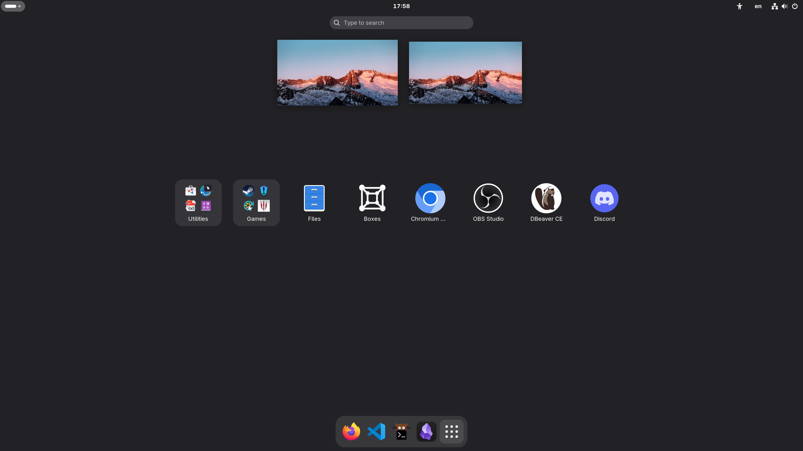
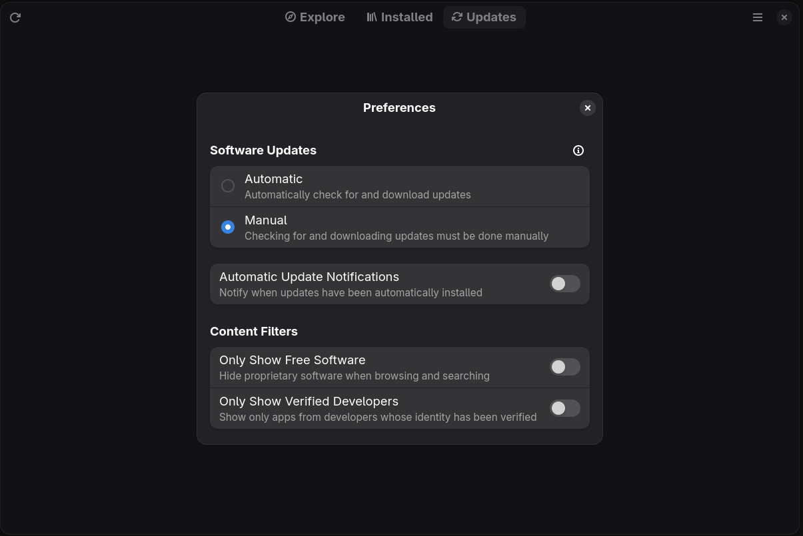

# TABLE OF CONTENTS

- [TABLE OF CONTENTS](#table-of-contents)
  - [content of this repository](#content-of-this-repository)
  - [requirements and dependencies](#requirements-and-dependencies)
  - [what does this automate](#what-does-this-automate)
  - [installation](#installation)
    - [install zsh and OhMyZsh](#install-zsh-and-ohmyzsh)
    - [installation script (if you're on desktop)](#installation-script-if-youre-on-desktop)
    - [installation script (if you're on laptop)](#installation-script-if-youre-on-laptop)
    - [setting up vscode and global settings.json and symlinking global AGENTS file](#setting-up-vscode-and-global-settingsjson-and-symlinking-global-agents-file)
  - [manual tasks](#manual-tasks)
  - [optional tips and commands you might want to consider](#optional-tips-and-commands-you-might-want-to-consider)
    - [nvm - install and use LTS nodejs and npm](#nvm---install-and-use-lts-nodejs-and-npm)
    - [install LTS version of chosen dotnet version -- installs at the same location as Rider](#install-lts-version-of-chosen-dotnet-version----installs-at-the-same-location-as-rider)
    - [login locally in pulumi](#login-locally-in-pulumi)
    - [login with github cli](#login-with-github-cli)
    - [update submodules when necessary](#update-submodules-when-necessary)
  - [DONATE](#donate)

## content of this repository

- VSCode as primary code editor.
- [Github Copilot](./copilot/) and [opencode](./opencode/.config/opencode/) for ai.
- dotfiles and configs managed by `GNU/Stow` - zsh, ghostty, opencode, cmus, gitconfig and more.
- zsh functions.
- Various installation scripts.

## requirements and dependencies

- Be on Fedora Workstation.
- Use gnome desktop environment, required for [gsettings](./install_scripts/set_gsettings.sh).
- Bash.
- Have ssh key configured with GitHub (cloning is done with SSH)

## what does this automate

- Installs `dnf` and `flatpak` packages
- Installs nerd font: `Hack Nerd Font`
- Installs `lazygit`
- Installs `nvm`
- Installs `act`
- Installs `vimv`
- Installs `docker` and `docker compose`
- Installs `postgres` and `dbeaver`
- Installs `obsidian` and `syncthing`
- Installs `opencode`
- Configures gnome settings with `gsettings`

And likely more.
For full info, check scripts themselves at

- [start_desktop](./start_desktop.sh) for desktop.
- [start_laptop](./start_laptop.sh) for laptop.

## installation

### install zsh and OhMyZsh

```bash
sudo dnf install -y zsh && sh -c "$(curl -fsSL https://raw.githubusercontent.com/ohmyzsh/ohmyzsh/master/tools/install.sh)"
```

### installation script (if you're on desktop)

```bash
curl -fsSL https://raw.githubusercontent.com/monoira/.dotfiles/main/start_desktop.sh | bash
```

### installation script (if you're on laptop)

```bash
curl -fsSL https://raw.githubusercontent.com/monoira/.dotfiles/main/start_laptop.sh | bash
```

### setting up vscode and global settings.json and symlinking global AGENTS file

1. open vscode - required so `$HOME/.config/Code/User` gets created
2. import [vscode profile](./code/profiles/prof.code-profile)
3. clone and open workspaces
4. run following script to symlink vscode global settings.json,
   which includes `vscode-vim` extension keybindings.

```bash
ln -sf "$HOME/.dotfiles/code/settings.json" "$HOME/.config/Code/User/settings.json"
```

**When everything finishes, reboot your system! VERY IMPORTANT!**

## manual tasks

- change placement of packages based on this:
  
- change software program preferences to this:  
  
- change refresh rate in `settings > refresh rate` to `120 Hz`
- add `Georgian` keyboard layout
- in `about:config` of firefox, change  
  `full-screen-api.warning.timeout`  
  to  
  `0`
- in Software, change gnome video player from `dnf` to `flatpak`, since flatpak version includes all codecs, free and proprietary

## optional tips and commands you might want to consider

### nvm - install and use LTS nodejs and npm

```bash
nvm install --lts && nvm use --lts
```

### install LTS version of chosen dotnet version -- installs at the same location as Rider

```bash
curl -sSL https://dot.net/v1/dotnet-install.sh | bash /dev/stdin --version 10.0.404
```

### login locally in pulumi

```bash
pulumi login --local
```

### login with github cli

pick `GitHub.com`, then `SSH` as the git protocol, and authenticate with your browser

```bash
gh auth login
```

### update submodules when necessary

```bash
git submodule update --remote --merge
git add . && git commit -m "chore: update submodules" && git push
```

## DONATE

I've been creating FOSS / GNU/Linux / nvim / web
related software for some time now.  
If you used, forked or took code from one of my projects and you
would like to support me 👍,  
you can donate here:

| type                | address                                    |
| ------------------- | ------------------------------------------ |
| Bitcoin (SegWit)    | bc1ql8sp9shx4svzlwv0ckzv8s7pphw5upvmt8m2m7 |
| Ethereum (Ethereum) | 0xf2FCB0Af39DF7A608b76297e45181aF23fEB939F |
